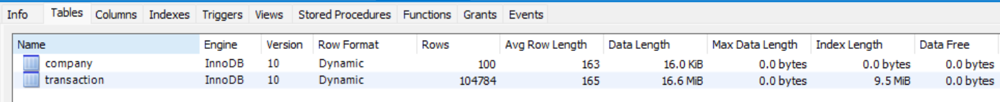
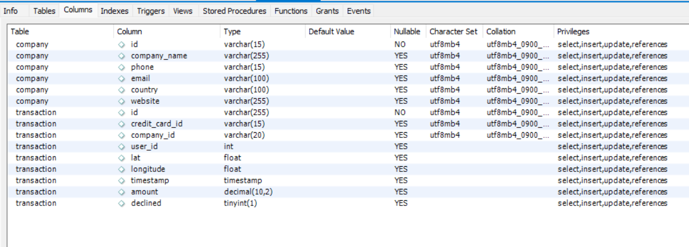

## 1. Introduction

This project explores the database structure
and relationships between two tables.

## 2. Data Importation

The database contains two tables:
- company
- transaction
Both tables use the InnoDB storage engine and the utf8mb4 character set for text fields.

The database contains information about companies and their financial transactions.

## 3. Database Schema

Database has the following structure:

## 4. Table Descriptions

The company table stores descriptive information about companies.
The transaction table stores information about financial transactions.

## 5. Variable Descriptions

Variables are the individual columns inside each table.

There are two main categories:

Company variables:
- Identification: id
- Company information: company_name, phone, email, country, website
Transaction variables:
- Identification: id, credit_card_id, company_id, user_id
- Location: lat, longitude
- Time: timestamp
- Financial information: amount
- Transaction status: declined

## 6. Relationships

The most important relationship in your database is between:
- company.id
- transaction.company_id
The company_id column identifies the company associated with each transaction.

The expected relationship is one-to-many (1:N):
- One company can have multiple transactions.
- Each transaction is associated with a company.

## 7. Schema Diagram

See the diagram above.

## 8. Conclusion

Summary of the database structure.
