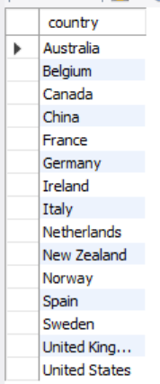
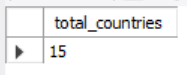
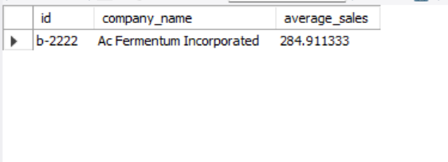

# Exercise 2 – SQL Queries Using JOIN

## 1. Introduction

The objective of this exercise is to practise SQL JOIN operations to analyse data from two related database tables: `company` and `transaction`.

The purpose is to combine information from both tables and answer business questions related to sales, countries and company performance.

## 2. Database Tables

This exercise uses two tables:

- **company:** Contains company information, including company ID, company name and country.
- **transaction:** Contains transaction information, including company ID, transaction amount and declined status.

The relationship between the tables is established using:

`company.id = transaction.company_id`

## 3. SQL Analysis and Business Questions

### Question 1: Which countries are generating sales?

**Objective:** Identify the different countries where companies have generated sales.

**SQL concepts used:**
- `INNER JOIN` to connect the two tables.
- `DISTINCT` to avoid duplicate countries.
- `ORDER BY` to organise the results alphabetically.

**Results:**

### Question 2: From how many countries are sales generated?

**Objective:** Calculate the total number of different countries generating sales.

**SQL concepts used:**
- `INNER JOIN` to connect the tables.
- `COUNT(DISTINCT)` to count unique countries.

**Results:**

### Question 3: Which company has the highest average sales?

**Objective:** Identify the company with the highest average transaction amount.

**SQL concepts used:**
- `INNER JOIN` to combine company and transaction data.
- `AVG()` to calculate the average transaction amount.
- `GROUP BY` to calculate the average for each company.
- `ORDER BY DESC` to rank companies from highest to lowest average.
- `LIMIT 1` to display only the company with the highest average.

**Results:**

## 4. Files Included

- `queries.sql`: Contains all SQL queries used in this exercise.
- `results/`: Contains screenshots of the query results.
- `README.md`: Explains the objectives, methodology and results of the exercise.
